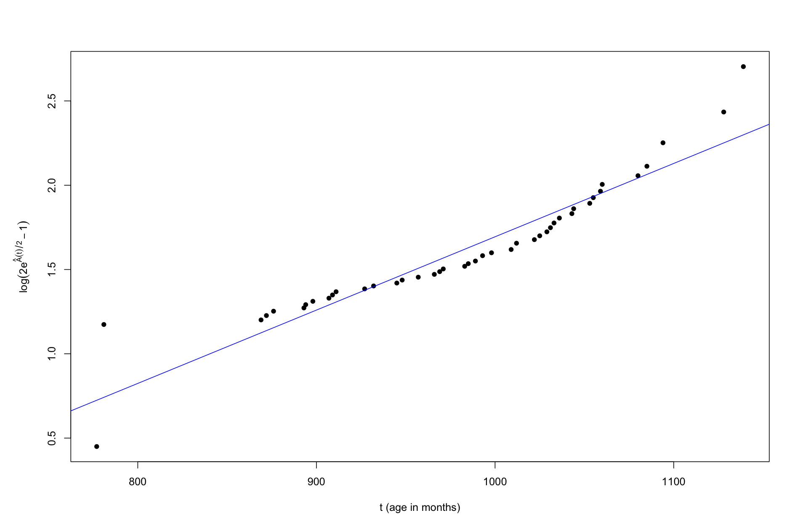
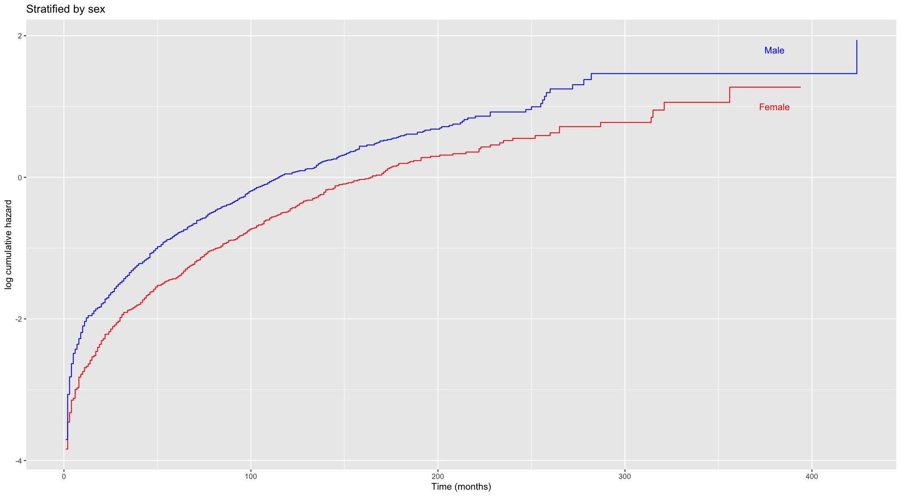
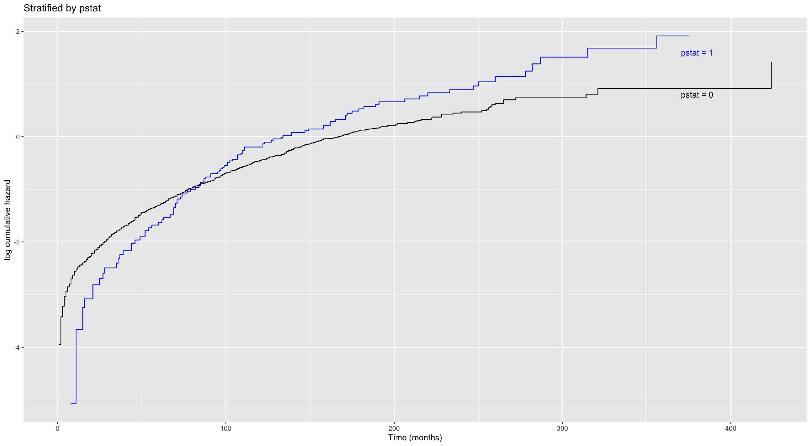

# Mortality Modelling: Survival Analysis in R

Survival analysis of real mortality data in R: estimating death rates, fitting parametric and Cox regression models, and testing whether each model's assumptions actually hold.

Completed as third-year coursework for **MATH39562 Mortality Modelling in Insurance** (April 2026).

**Skills:** R · survival analysis · maximum likelihood estimation · Cox proportional hazards regression · hypothesis testing · model diagnostics · ggplot2

---

## Key results

| Question | Method | Result |
|---|---|---|
| Do two groups have different death rates? | Kaplan–Meier estimate, log-rank test | χ² = 1.99 < 3.84, so there's **no significant difference** at the 5% level |
| What parameter best fits the mortality of Channing House males? | Maximum likelihood with left-truncation and right-censoring | θ̂ = **0.00334** |
| Does that parametric model fit the data? | Nelson–Aalen estimate with a linearising transform | **Roughly linear**: a reasonable fit with some curvature at the youngest and oldest ages |
| How much riskier is one patient than another? | Cox proportional hazards model | Patient A's hazard is **52% lower** than Patient B's (HR = 0.479) |
| Chance Patient A dies in year 3, given survival to year 2? | Breslow estimator | **6.3%** |
| Does malignancy status (`pstat`) matter? | Likelihood ratio test | Statistic 5.22 > 3.84, so it is **significant** |
| Is the proportional hazards assumption valid? | Stratified Cox models, log cumulative hazard plots | **Holds for sex, fails for `pstat`** |

## Highlights

### Checking a parametric model against the data

I derived the cumulative hazard of the model, then rearranged it so that a correct model gives a straight line. Plotting the transformed Nelson–Aalen estimate shows a broadly linear trend, so the model is reasonable but not perfect.



### Testing the proportional hazards assumption

A Cox model assumes the hazard ratio between groups is constant over time. If that's true, the log cumulative hazard curves for two groups should stay a constant distance apart.

| Stratified by sex: assumption holds | Stratified by `pstat`: assumption fails |
|---|---|
|  |  |
| The curves stay roughly parallel. | The curves cross at about 75 months and then move apart. |

## Data

Both datasets come with R packages, so nothing needs to be downloaded:

- **`channing`** (KMsurv): residents of the Channing House retirement community. Entry age causes left-truncation.
- **`mgus2`** (survival): patients with monoclonal gammopathy, with age, sex, haemoglobin and malignancy status.

## Repository contents

```
├── mortality_modelling.R   # all the analysis code, in sections
└── figures/                # plots used in this README
```

## How to run

Install the packages once, then run the script:

```r
install.packages(c("survival", "KMsurv", "ggplot2"))
source("mortality_modelling.R")
```

Tested with R 4.5.
